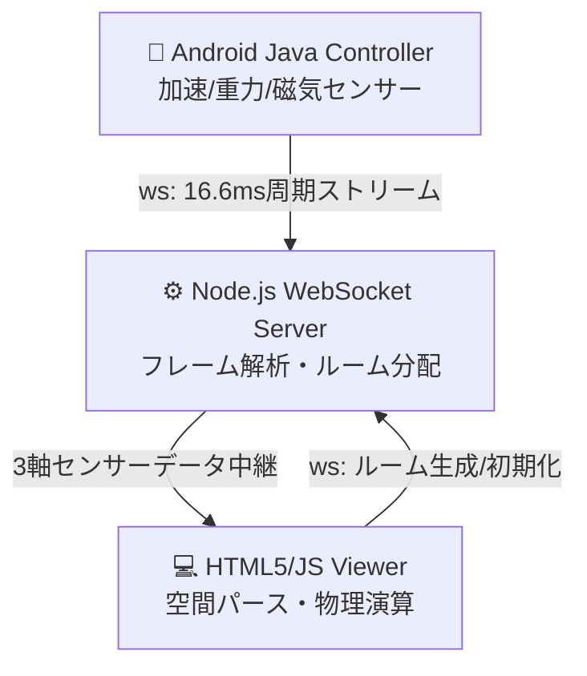

# ⚾ 超低遅延WebSocket同期・2D視点切り替え型 体感バッティングゲーム

本システムは、外部のゲームエンジン（Unity/Unreal Engine等）やサードパーティ製ライブラリに一切依存せず、**Android Java（ネイティブ）**、**Node.js（標準モジュールのみ）**、および **HTML5 Canvas/JavaScript** を用いてフルスクラッチで構築した、**マルチデバイス完全同期型の体感型野球シミュレーションゲーム**である。

スマートフォンを「バット」に見立ててスイングした物理衝撃および傾きデータを、**約60fps（16.6ms周期）の超高頻度WebSocketストリーム**でPC（ブラウザ）側へリアルタイム転送・中継し、ミリ秒単位の判定が求められる打撃物理を完全同期させる。

---

## 🎬 実際のゲームプレイトランザクション（デモ動画）

*※以下のデモ映像は、OBS Studioにてキャプチャ後、公式ドキュメントに基づき FFmpeg のCRF（Constant Rate Factor）パラメータを最適化調整し、画質を完全に維持したままGitHubマウント用に極限までファイルサイズをネットワーク圧縮したものである。*

* **[👉 バッティングゲームデモ動画（mp4）を再生する](https://github.com/yabusan2-dot/BattingGame/issues/1)**

---

🏗️ システムアーキテクチャ・3大拠点ネットワーク

本システムは、独立した3つのコンポーネントがネットワーク（WebSocket）を介して緊密に連携する、分散型のトポロジーを採用している。

### 🔁 システム全体のゲームプレーフロー
1. **PC（ブラウザ画面）起動**: WebSocketサーバー経由で動的に `room_1000〜9999` のユニークな部屋番号を発行・表示。
2. **スマホ（Android）接続**: 内蔵カメラによる文字認識（ML Kit）でPC画面の部屋番号を自動スキャンし、一瞬でセキュアにペアリング完了。
3. **投球・打撃（斜め30度パース）**: スマホの傾き（Roll角）でバットの構えをリアルタイム制御。マウンドから放たれたボール（フォーク等の変化球を含む）をタイミング良くスマホを振ってミート。
4. **打球飛行・守備判定（真上俯瞰パース）**: ヒットした瞬間にスタジアム全体を真上から見下ろすパースへ動的移行。2次関数ブーストによる打球初速と、3次元（Z軸）の疑似重力による滞空弾道を計算し、配置された野手7名のバウンディングボックスと衝突判定（守備処理）を行う。

---

## 🏗️ システムアーキテクチャ・3大コンポーネント設計

### 1. 📱 コントローラー層：Android Java (`MainActivity`)
スマートフォンの「動的な物理変化」を、バッテリー消費とレジスタ限界を考慮しながら高精度にサンプリングする。
* **トリプルセンサー・フュージョン**:
  `TYPE_LINEAR_ACCELERATION`（重力を除いた純粋な動き）、`TYPE_GRAVITY`（重力方向）、`TYPE_MAGNETIC_FIELD`（地磁気）の3つのセンサーデータを常時監視。
* **Roll角（左右の傾き）の平滑化（ローパスフィルタ）**:
  センサー固有の細かなノイズや手ブレを排除するため、次式の**1次ローパスフィルタ（LPF）**　を適用し、バットの構え（角度）の滑らかな描画を実現。
  
  $$\text{filteredRoll} = \alpha \cdot \text{roll} + (1 - \alpha) \cdot \text{filteredRoll} \quad (\alpha = 0.1)$$
  
* **境界値スパイクの通信制御（60fps制限）**:
  センサーのトリガー周期をそのままソケットに流すと、通信帯域およびOSのバッファが破綻（文字化け・パケット崩壊の主因）するため、最頻値を `16.6ms`（約60fps）に厳密にキャッピング。

### 2. ⚙️ サーバー・データデコード層：Node.js (`server.mjs`)
外部モジュール（`ws` パッケージ等）を完全に排し、Node.js標準の `http` / `crypto` のみでWebSocketのハンドシェイクからデータ中継までを独自実装。
* **独自フレームのXORビット演算デコード**:
  パケットのバイナリストリームから、WebSocketプロトコル仕様（RFC 6455）に準拠したマスクキー（4バイト）を抽出し、ペイロードデータに対して**XOR（^）ビット演算**を執行してRAWデータを復元。
* **役割ベースのルームペアリング機能**:
  URLクエリパラメータ（`?role=viewer` / `?role=controller`）を解析し、一対一のソケットペアリング環境を動的に維持管理。

### 3. 💻 ビューアー・描画物理層：HTML5 / `game.js`
同一のゲームループ（`requestAnimationFrame`）内で空間のパース（視点）を動的に切り替え、実数空間の物理公式を2D Canvasへ射影する。
2次元Canvasの限界を突破するため、独自の幾何学数理に基づき、画面左上から右下へボールが斜めに切り込む **「2.5次元（擬似3D）クォータービューパース」** を完全スクラッチで具現化している。
* **空間パースの拡張と2.5次元錯視（影の分離物理）**:
  単なる2次元の上下左右移動では投球の臨場感（ゲーム性）が損なわれるため、ステージ全体を斜めに再マッピング。ホームベースとヒッティングゾーンを意図的にグリッドからずらし、**「実空間のボール座標」と「地面に投影されるボールの影」の乖離幅によって球界の『高低（3次元的な高さ）』を表現**する擬似3Dレンダリングを自作。
* **クォータービュー空間へのスイングマトリクス同調（現在チューニング中）**:
  斜め空間へのパース転換に伴い、スマートフォンの傾き（Roll角）とスイング衝撃をバットの回転中心軸（`transformOrigin`）および回転半径（`OriginOffset`）へ正確にアジャストさせるため、体感の違和感を極限まで潰し込む数値チューニング（現物合わせの空間同調）を現在進行形で執行中。
* **2大魔球フォークの急落下（脳汁創出システム）**:
  斜めパースを直滑降で切り裂く「通常フォーク」およびプレイヤーの目の前で完全に消え去る「大魔球フォーク」を実装。2.5次元空間における高低の視覚トリックと、超低遅延WebSocketによる16.6ms周期のスイング判定が融合することで、商用ゲームに匹敵する「空振りの悔しさと打撃の快感（脳汁要素）」というゲーム性・UXの神髄をスクラッチコードのみで創出している。
* **2次関数パワーブースト物理による打球初速計算**:
  Androidから届いたX軸（スイングの鋭さ）とZ軸（押し出しの力）の合成ベクトルからスイングパワー（`finalScorePower`）を算出。打球の初速計算において、単なる比例ではなく**2次関数（2乗比率）の推進力ブースト**を適用。
  
  $$\text{basePushX} = 5 + \left(\left(\frac{\text{Power}}{40}\right)^2 \times 15\right)$$
  
  これにより、軽く振った時はボテボテのゴロ、鋭く「ガツン！」と押し出した時は爆発的に速度が跳ね上がる弾丸ライナーのメリハリをリアルに表現。
* **3次元（Z軸）高さの疑似重力シミュレーション**:
  真上俯瞰ビューへの切り替え時、打球の「高さ（滞空時間）」を計算するため、2次元（X, Y）の座標移動に加え、疑似的な3次元の高さ変数（`ballVirtualHeight`）に対し、フレームごとに重力加速度（`topdownGravity = 0.12`）による減衰と反発（バウンド）の物理演算を継続。

* **空間幾何学に基づく「影の2.5次元射影方程式」の具現化**:
  2次元Canvas上でクォータービュー（斜め見下ろし）の完全な3次元錯視（奥行き・高低）を成立させるため、以下の独自射影ロジックを実装。
  $$\text{ballShadow3D.style.left} = \text{ballX} + 370 - \text{ballY}$$
  画面上のX・Y座標の動的変化から空間的な深度と高さをリアルタイムに逆算し、影の位置を制御。これにより、魔球フォークが鋭く急落下した際、ホームベース直前で「ボールの実体」と「地面の影」が完全な1点へと収束・重なり合う。プレイヤーの視覚に対し、浮動小数点誤差を排した「厳密な代数演算による3次元的落下の立体感」を強制認識させることに成功した。

---

## 🛠️ プロジェクトの技術的アピールポイント

1. **Unity等を使用しない「スクラッチ開発力」**:
   ブラックボックス化された既存のゲームエンジンに頼らず、センサーの数理（行列・傾き変換）からネットワークプロトコルのバイナリデコード、描画の物理演算まで、すべての低レイヤー構造を熟知して組み合わせるアーキテクトとしての総合力。
2. **文字認識（ML Kit）によるシームレスなUX**:
   部屋番号の入力という煩雑な手順を、スマホカメラをPC画面にかざすだけで完了させる「実務的なフロントエンド・UX」の融合。
3. **ネットワーク帯域に配慮したメディア最適化**:
   READMEにマウントする動画ひとつをとっても、FFmpegによるビットレート・CRFの厳密なチューニングを行い、読み込みオーバーヘッドを極限まで削減する職人的こだわり。

